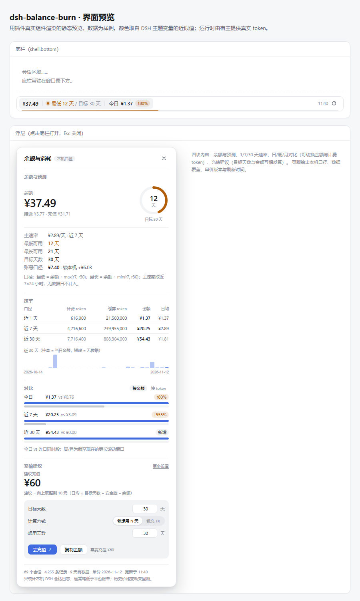

# dsh-balance-burn · DeepSeek 余额消耗看板

把「我还有多少钱」升级成「**还能撑多久、花得多快、该充多少**」。

底栏常驻一行：余额、最低可用天数与目标天数、今日消耗与较昨日同时段的变化；点开浮层可核对每个数字的算法、查看 1/7/30 天速率与日/周/月对比，并按目标天数给出充值建议。



## 它回答什么

| 问题 | 位置 |
| --- | --- |
| 余额还有多少 | 底栏 · `¥37.49` |
| 还能用多久 | 底栏 · `最低 12 天 / 目标 30 天`，最低低于目标时转琥珀色 |
| 今天花了多少、比昨天快吗 | 底栏 · `今日 ¥1.37 ↑80%` |
| 花费速度 | 浮层 · 近 1 / 7 / 30 天的计费 token、缓存 token、金额与日均 |
| 最近 30 天的波动 | 浮层 · 每日柱状（无数据日画短线，不画成 0） |
| 比上周、上个月呢 | 浮层 · 日 / 周 / 月三组对比，可切换「按金额 / 按 token」 |
| 该充多少 | 浮层 · `建议充值 ¥60`，可反算「我想用 N 天」或「我充 ¥X」，并一键跳转平台充值 |

## 口径（会显示在界面上）

- **只统计本机 DSH**：读取 `~/.dsh/sessions/**/session.v4.jsonl.zstd`（以及旧版 `session.jsonl.zstd`）里的 `assistant/message` usage，不抓平台账单，也不等于平台账单。
- **计费 token** = 未命中缓存的输入 + 输出；**缓存 token** 只算 `cacheReadTokens`，单独展示，不混进「用了多少」。
- **金额** = token × 官方单价，按调用时间判定峰谷。单价表版本 `2026-11-12`，来源见设置页。
- **速率** = 截至现在的滚动 n×24 小时消耗 ÷ n，不是自然日切分，避免「今天才过一半」失真。
- **最低可用** = 余额 ÷ max(r7, r30)；**最长可用** = 余额 ÷ min(r7, r30)。底栏的「最低 N 天 / 目标 M 天」以最低值做提醒线，底边的细条就是「最低 ÷ 目标」的进度。
- **目标天数**（默认 30）只负责两件事：建议充值的计算，以及底栏的提醒线；主速率仅用于日均展示与充值计算。
- **建议充值** = 向上取整到 10 元（主速率 × 目标天数 + 安全垫 − 余额），下限 0。
- **对比**：今日 vs 昨日同一时段；周/月为等长的滚动窗口。
- **账号口径**：相邻两天余额快照的减少额，覆盖同一账号下的全部调用；只在「连续两天且余额未上升」时出现，不解释充值或断档。
- **无数据**的日期不计入均值，也不会显示成 0。

## 安装

要求：DSH 44.x、Node ≥ 22.15（使用内置 Zstandard 解码）。

1. **先卸载 `dsh-quota-bar`**。底栏 `shell.bottom` 是单槽位，两者同时安装会互相顶掉。
2. 在 DSH 的 **设置 → 插件** 里安装本地包（推荐），或手动写入 `~/.dsh/profiles/desktop/package.json`：

   ```json
   {
     "dependencies": { "dsh-balance-burn": "file:D:\\dsh-balance-notify" },
     "dsh": { "profile": { "bundles": ["…原有 bundle…", "dsh-balance-burn"] } }
   }
   ```

   然后在 `~/.dsh/profiles/desktop` 执行 `pnpm install`。
3. 重启 DSH（或重载窗口）。底栏出现余额即安装成功。
4. 打开一次 **设置 → 余额与消耗** 可调整目标天数、安全垫、主速率口径、刷新周期与节假日。

> 余额需要 `DEEPSEEK_API_KEY`。插件通过宿主凭据通道读取，密钥不会进入浏览器；未配置时底栏仍显示本机消耗，余额处显示「余额不可用」。

## 配置

| 配置 | 默认 | 范围 / 说明 |
| --- | --- | --- |
| 目标天数 | 30 | 1–365，决定建议充值，也是底栏提醒线 |
| 安全垫 ¥ | 5 | 0–10000，预警线与建议充值都加它 |
| 主速率口径 | r7 | r1 / r7 / r30 |
| 刷新周期 | 60s | 15–600s；页面隐藏时暂停轮询 |
| 节假日（停峰） | 空 | `YYYY-MM-DD`，逗号分隔；当天全天按空闲价 |

配置存放在 `~/.dsh/storages/balance-burn/settings.json`；余额快照在同目录 `balance-history.json`，每个自然日保留最后一条。

## 开发

```powershell
# 单元测试（Node 内置 test runner）
npm test

# 打印真实环境的一份快照（不联网取余额）
node scripts/report.mjs

# 重新生成静态界面预览（需要 React）
npm install --no-save react@19.2.0 react-dom@19.2.0
node scripts/render-preview.mjs
```

设计说明、数据流与全部取舍见 [DESIGN.md](./DESIGN.md)。

## 已知边界

- 历史价格变动不回溯：30 天前的调用也按当前单价表估算。
- **本机日志会略低于平台账单**：实测 10-21 ~ 11-12 本机 ¥46.78、平台 ¥49.10（低 4.7%）。标题生成、失败/重试调用不一定写入 usage；平台搜索/抓取按次计费，也不在 token 口径内。
- 余额币种为 USD 时，不猜汇率，天数与建议充值显示为不可计算。
- 节假日表不内置（无法可靠预测未来法定假日），由设置补充。
- 已包含余额快照差值（账号口径）；不包含异常日标注与消耗进度（近 30 天柱状已提供）。
